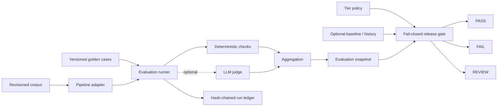
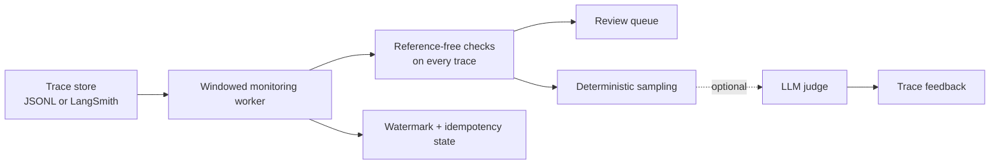

# Manufacturing RAG Evaluation & Monitoring

> **A safety-oriented evaluation and release-gating proof of concept for manufacturing RAG.**
> Tests whether an assistant uses current procedures, preserves exact values and identifiers,
> includes required warnings, and abstains when it should.

This project explores a practical question: **how do you keep a RAG system from shipping a
plausible-sounding but operationally wrong answer?**

It combines deterministic, domain-specific checks with optional LLM-as-judge metrics, policy-based
release decisions, reproducible run artifacts, and an online trace-monitoring worker. The project
runs locally against a small synthetic dataset; it is a **working proof of concept, not a
production-certified safety system**.

## Why this problem matters

In manufacturing, a RAG answer can be fluent and still be unsafe or unusable if it cites a
superseded procedure, changes a torque value, invents a part number, drops a warning, or answers
without sufficient evidence. Generic answer-similarity scores alone do not reliably catch these
failures.

This project treats those requirements as explicit, testable release criteria:

- A stale-revision or critical safety-check failure can block a release.
- Missing or invalid evaluation evidence fails closed instead of being treated as success.
- Exact checks are primary for exact requirements; an LLM judge is an optional second opinion.
- Every run records the inputs and configuration needed to interpret its results.

## At a glance

| Area | Implemented capability |
|---|---|
| Offline evaluation | Golden cases, pluggable pipeline contract, deterministic demo RAG pipeline |
| Safety and quality metrics | Revision, citation, identifier, numeric/unit, warning, required/forbidden content, and refusal checks |
| Release governance | T1/T2/T3 policy, S1 critical-case enforcement, absolute floors, regression checks, review guardrails |
| Measurement | Severity-weighted score, pass rates, Wilson lower bounds, latency and token metrics |
| Run evidence | Versioned metadata, snapshots, and a verifiable hash-chained JSONL ledger |
| Online monitoring | Trace adapters, reference-free L0 checks, stable sampling, idempotent worker, review queue |
| Extensibility | Pipeline and trace-store protocols; optional DeepEval judge |
| Quality automation | CI lint, formatting, type checks, tests, schema check, gate self-test, and secret scanning |

## The release gate in a minute

```powershell
uv sync
uv run mfg-rag-eval demo
```

The demo runs three stages:

1. **Baseline:** evaluate the good pipeline and save its snapshot.
2. **Control:** evaluate the unchanged pipeline again; it should **PASS**.
3. **Regression:** simulate stale-revision retrieval and dropped `WARNING` lines; it should
   **FAIL** under the T1 policy.

On the bundled synthetic cases, the regression run demonstrates the gate catching a critical
failure, a revision-currency pass rate of `0.778` against a `1.000` floor, and a mandatory-warning
pass rate of `0.333` against a `1.000` floor. Those values demonstrate the mechanism on this
fixture; they are **not production accuracy claims**.

> **Heads-up:** the `demo` command clears and recreates the generated `runs/` directory. Back up
> anything in that directory that you want to keep.

See the [full sample output](docs/sample-output.txt) and the [architecture notes](docs/architecture.md).

## How the system works

### Offline evaluation and release gate



The runner invokes one pipeline instance across the golden suite, records its manifest and
per-case results, aggregates measurements, and writes a snapshot. The release gate evaluates
critical failures, run errors, metric completeness, policy floors, regression tolerances, history,
and operational guardrails. **Any FAIL takes precedence over REVIEW; any REVIEW takes precedence
over PASS.**

### Online monitoring



Unlike offline evaluation, production traces generally do not have golden answers. The online
worker therefore applies reference-free checks to every trace and can optionally judge a stable,
deterministically selected sample. It writes flagged traces to a local review queue and persists
processing state to make overlapping-window reprocessing idempotent.

## Evaluation signals

### Deterministic checks

These are the primary signals for measurable requirements. They are fast, repeatable, and
inspectable; an LLM judge cannot override a deterministic failure.

- **Retrieval:** evidence recall and mean reciprocal rank (MRR), matching document *and revision*.
- **Citations:** resolvability and accuracy against expected evidence.
- **Revision currency:** whether cited documents are the current approved revision.
- **Identifier fidelity:** expected identifiers are present and unsupported identifiers are absent.
- **Numeric and unit fidelity:** checks required values and units, including normalization of
  full-width digits and common decimal/thousands separators.
- **Required content:** mandatory warnings and required terms are preserved.
- **Refusal behavior:** answerable requests are not incorrectly refused, and refusal cases abstain.
- **Other content rules:** forbidden content is checked where a golden defines it.

Not-applicable metrics are omitted for cases where the metric has no meaning; they are not counted
as passes.

### Optional LLM-as-judge

The optional DeepEval adapter evaluates faithfulness and answer relevancy. Supported judge specs
include `openai:<model>`, `ollama:<model>`, and `grok:<model>`. The selected judge and DeepEval
version are recorded as a judge-pack identifier.

LLM judging is a **complement**, not a safety oracle: it can be nondeterministic, costly, unavailable,
and sensitive to model or prompt changes. The default offline demo does not need a judge, network
access, or API credentials.

## Release policy: explicit risk tiers

Policy is defined in [`policies/tiers.yaml`](policies/tiers.yaml), separately from the metric
implementation.

| Tier | Intended use | Example |
|---|---|---|
| **T1** | Safety-critical | Lockout/tagout or safety-critical torque |
| **T2** | Quality-critical | Inspection or supplier specifications |
| **T3** | Informational | General maintenance-history lookup |

The policy assigns critical metrics, permitted S1 failures, required gate metrics, absolute floors,
guardrails, operational ceilings, and approval roles. Case severity (`S1`/`S2`/`S3`) is distinct
from application tier (`T1`/`T2`/`T3`).

The gate fails closed for S1 critical failures, run errors, missing or non-finite required metrics,
floor violations, and gate-metric regressions beyond tolerance. Guardrail regressions or operational
ceiling breaches produce **REVIEW**. Wilson lower bounds help communicate small-sample uncertainty;
they do not make a small dataset representative.

## Run artifacts and provenance

Each evaluation writes generated artifacts under its run directory:

- `snapshot.json`: aggregate metrics plus dataset, policy, corpus, manifest, and judge metadata.
- `ledger.jsonl`: run-start, per-case, and run-end records linked by SHA-256 hashes.

The pipeline manifest ID fingerprints relevant pipeline configuration. Dataset and policy file
hashes help identify the exact evaluation inputs. `ledger-verify` detects modified, removed, or
reordered records in the chain.

The ledger is **tamper-evident, not immutable**: someone able to rewrite the whole file can
recompute its hashes. A production deployment would need protected/WORM storage and a signed ledger
head.

## Run it locally

### Requirements

- Python 3.12 or newer
- [uv](https://docs.astral.sh/uv/)

### Quick start

```powershell
uv sync
uv run mfg-rag-eval demo
```

### Other useful commands

```powershell
# CI-style behavioral check: clean pipeline passes and broken pipeline is blocked
uv run mfg-rag-eval selftest

# Evaluate one regression variant
uv run mfg-rag-eval run --variant stale

# Run the local online-monitoring simulation
uv run mfg-rag-eval online-demo

# Verify the demo's run ledger
uv run mfg-rag-eval ledger-verify runs/candidate_broken/ledger.jsonl

# Run tests with coverage
uv run pytest --cov
```

### Optional judge integrations

Install optional dependencies only if you intend to use them:

```powershell
# DeepEval judge and Ollama client
uv sync --extra judge

# LangSmith trace adapter
uv sync --extra tracing

# Optional LangChain/Chroma integrations for a real RAG stack
uv sync --extra rag
```

For a Grok judge, create a local `.env` from the template, then add a valid key:

```powershell
Copy-Item .env.example .env
notepad .env
uv run mfg-rag-eval run --variant good --judge grok:grok-beta
```

Set `XAI_API_KEY` or `GROK_API_KEY` in `.env` or the process environment. Never put a real key in
`.env.example` or commit it. The Grok and live LangSmith paths have not been verified against live
services in this proof of concept.

For local Ollama judging, also run the Ollama service and have the selected model available locally:

```powershell
uv run mfg-rag-eval run --variant good --judge ollama:llama3.1
```

## Integrate a RAG application

Implement the [`PipelineAdapter`](src/mfg_rag_eval/adapters/pipeline.py) protocol around the
application’s own retrieval and generation stack:

- `manifest()` describes the configuration that defines the run (for example, model, prompt,
  retriever, `top_k`, and corpus/index snapshot).
- `invoke(query)` returns a typed result with the answer, citations, retrieved chunks, latency,
  and token counts.

The evaluator owns the evaluation contract and release policy; it does not own the application’s
RAG pipeline. Trace ingestion follows a similar [`TraceStore`](src/mfg_rag_eval/adapters/trace_store.py)
protocol, with JSONL and LangSmith adapters.

## Repository map

```text
src/mfg_rag_eval/
  adapters/    Pipeline and trace-store contracts and adapters
  metrics/     Deterministic checks and optional DeepEval judge
  gating/      Aggregation, policy loading, fail-closed verdict
  online/      Trace checks, stable sampler, windowed worker
  ledger/      Hash-chained run ledger and verification
  runner.py    Offline evaluation orchestration
  cli.py       Command-line interface
goldens/       Versioned synthetic golden set and JSON schema
policies/      Tier-specific release policy
data/          Synthetic revision-controlled corpus
docs/          Architecture, decisions, sample output, reference review
tests/         Unit and end-to-end behavior checks
```

## Quality and CI

The GitHub Actions workflow runs:

- Ruff lint and formatting checks.
- Mypy type checking.
- Pytest with the configured coverage threshold.
- A check that the committed JSON schema matches the Pydantic model.
- The release-gate self-test: the clean pipeline must pass and the deliberately broken one must
  fail.
- Ledger verification for the generated broken-candidate run.
- Secret scanning.

See [`ci.yml`](.github/workflows/ci.yml), the
[reference review](docs/reference-review.md), and the
[architecture decisions](docs/adr/).

## What is implemented vs. design-only

**Implemented as a local proof of concept:** offline runner, synthetic BM25/extractive pipeline,
deterministic metrics, policy-based release gate, aggregation, snapshots, hash-chain ledger, JSONL
trace store, LangSmith adapter, online worker, and CLI.

**Design-only:** federated regional control plane, aggregate-only global dashboard, signed policy
bundle distribution, air-gapped bundle management, and human review UI. The adapter shapes support
extension; they do not mean those integrations are deployed.

## Limitations and responsible interpretation

- The corpus and golden set are small and synthetic; results demonstrate mechanics, not real-world
  manufacturing accuracy.
- A small golden set cannot establish a low safety failure rate. A real deployment needs larger,
  representative, SME-reviewed data and carefully maintained holdout cases.
- Tolerances in the example policy are placeholders; calibrate them using repeated unchanged runs.
- Numeric and text normalization has locale and domain edge cases and needs plant-specific review.
- Optional judge behavior and live service integrations require separate end-to-end validation.
- This project is not a certified safety instrument and does not replace engineering, quality, or
  plant-safety approval.

## Background and attribution

The project’s golden-dataset, judge-metric, snapshot/compare, and online-scoring patterns were
informed by the open-source RAG evaluation course repository
[`rag-eval-deepeval`](docs/reference-review.md). The manufacturing-specific metrics, severity
policy, fail-closed gate, ledger, adapters, and monitoring design are developed for this project.
See the [reference review](docs/reference-review.md) for the comparison and documented changes.

## License

No license file is currently included. Add a license before accepting external contributions or
communicating reuse permissions.
