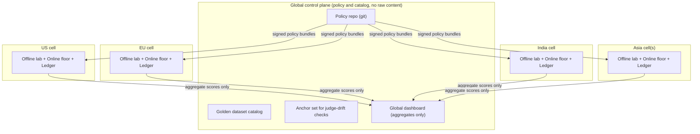
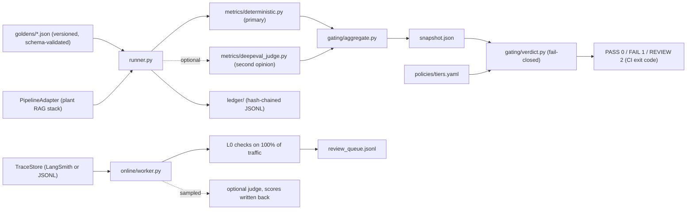

# Architecture

This repository implements one slice of a larger reference design: a federated evaluation and
monitoring platform for manufacturing RAG applications across regions (US, EU, India, Asia).
What is **implemented** and tested is called out explicitly; everything else is design only.

## 1. Federated topology (design)

Queries, answers, retrieved chunks and judge reasons never leave their cell. Only aggregate
scores, counts, manifest IDs and judge-pack versions cross borders. See ADR 0001.

## 2. Inside one cell (implemented in this repo)

## 3. Module map

| Path | Responsibility | Status |
|---|---|---|
| `models.py` | Typed contracts: goldens, pipeline I/O, results, traces | implemented |
| `adapters/pipeline.py` | `PipelineAdapter` contract + deterministic demo pipeline with regression variants | implemented |
| `adapters/trace_store.py` | `TraceStore` protocol, JSONL store, LangSmith store (unit-tested with a fake client) | implemented |
| `metrics/deterministic.py` | Retrieval, citation, revision, identifier, numeric/unit, warning, refusal metrics | implemented |
| `metrics/deepeval_judge.py` | Faithfulness and answer relevancy via DeepEval (cloud or local judge) | implemented, not exercised end-to-end here |
| `gating/` | Aggregation (Wilson bounds, weighted score), YAML policy, fail-closed verdict | implemented |
| `ledger/` | Append-only hash-chained run ledger with verification | implemented |
| `online/` | Deterministic sampler, L0 checks, windowed idempotent worker, review queue | implemented |
| `runner.py`, `cli.py` | Orchestration and commands | implemented |
| Regional cells, dashboards, air-gapped bundles, human review UI | | design only |

## 4. Verdict logic

Evaluated in order; any FAIL beats any REVIEW beats PASS.

1. S1 critical failure on a tier-critical metric: **FAIL**
2. Pipeline or judge errors during the run: **FAIL**
3. A gate metric missing, null or NaN: **FAIL**
4. Absolute floor violated: **FAIL**
5. Gate metric regressed vs baseline beyond tolerance: **FAIL**
6. Gate metric below the median of the last N approved releases: **FAIL**
7. Guardrail regression or operational ceiling breached: **REVIEW**

## 5. Tiers

| Tier | Meaning | Examples |
|---|---|---|
| T1 | Safety-critical | lockout/tagout, chemical handling, safety-critical torque |
| T2 | Quality-critical | inspection specs, ISO/IATF clauses, supplier specs |
| T3 | Informational | maintenance history, general lookup |

Policy per tier lives in `policies/tiers.yaml`.
